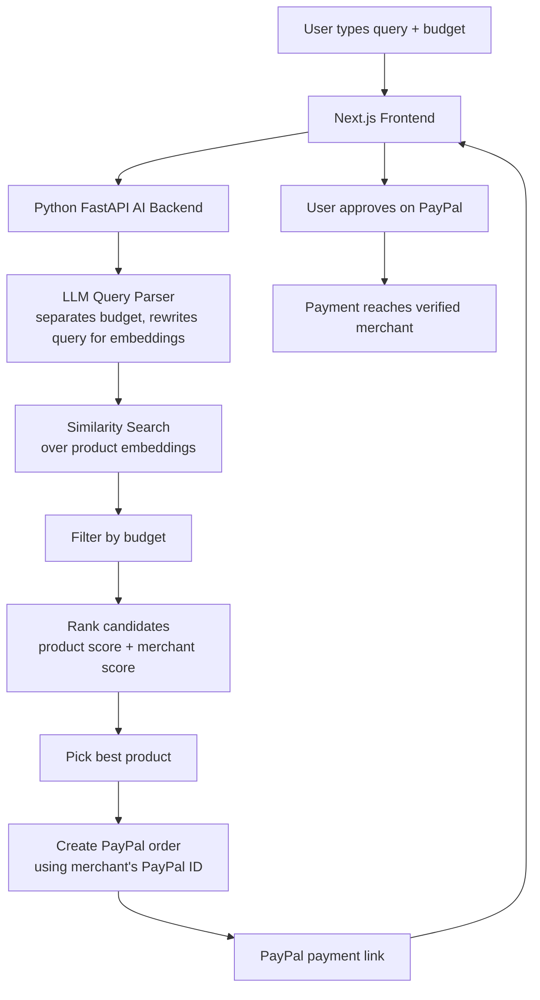
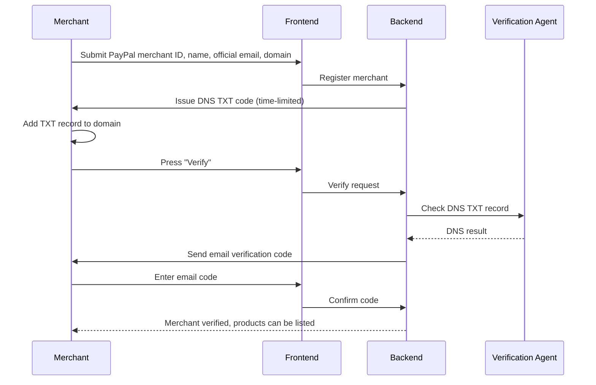
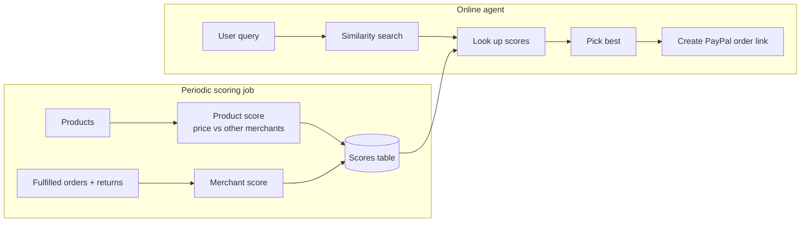

# 👻 GhostBuyer

**An AI shopping agent that finds the best product for your budget, ranks it by product trust and merchant trust, and hands you a ready-to-pay PayPal link.**

Built for the **PayPal Hackathon**. All payments run through PayPal's APIs.

- 🌐 Frontend (Vercel): `<your-vercel-url>`
- ⚙️ AI backend (Render): https://ghostbuyer.onrender.com
- 🎥 Demo video: `<link>`

---

## The problem

Online shopping has two trust problems:

1. **Fake or overpriced listings.** It is hard to tell a real product at a fair price from a scam listing.
2. **Unreliable merchants.** Even a real listing can come from a merchant who ships late, never ships, or has a high return rate.

Shoppers end up comparing tabs by hand and paying on faith.

## The solution

You tell GhostBuyer what you want and your budget, in plain English. GhostBuyer:

1. Understands your query and separates the **budget** from the **product need**.
2. Searches the marketplace for matching products.
3. Scores every candidate on **product score** and **merchant score**.
4. Picks the best one and creates a **PayPal order** for the verified merchant.
5. Returns a **PayPal payment link** that you approve.

You never pay a merchant the platform has not verified.

---

## Features

- 🗣️ **Natural-language search.** An LLM splits "good running shoes under ₹3000" into a budget and a retrieval-friendly query.
- 🔎 **Semantic product retrieval.** Similarity search over product embeddings.
- 📊 **Dual trust scoring.**
  - **Product score:** price compared against the same product across merchants, plus listing authenticity.
  - **Merchant score:** built from fulfilled orders and returns.
- 🏪 **Multi-tenant merchant onboarding.** Merchants register with their PayPal merchant ID, name, and official email.
- ✅ **Merchant verification.** DNS TXT record check on their domain, then an email verification code.
- 💳 **PayPal order creation.** The order is created against the verified merchant's PayPal ID and returned as a payment link.
- 🤖 **Autopay option.** When on, the agent creates the order link directly. Payment is always approved by the user on PayPal.

---

## How it works (full flow)

### 1. End-to-end user flow



### 2. Merchant onboarding and verification



### 3. Scoring pipeline

Scoring is split into two parts so that the online request stays fast.



**Trust score = product score + merchant score**

| Signal | Meaning |
| --- | --- |
| Product score | How fair and authentic the listing is. Price is compared in-house against the same product sold by other merchants. |
| Merchant score | Reliability of the merchant, from fulfilled orders and returns. |
| Final rank | Combined trust score, filtered by the user's budget. |

---

## Architecture

| Layer | Tech | Hosted on |
| --- | --- | --- |
| Frontend + API routes | Next.js | Vercel |
| AI backend | Python, FastAPI | Render |
| Agents | Hugging Face `smolagents` multi-agent orchestration | |
| LLM | Ollama (Qwen) | |
| Payments | PayPal REST API (create order) | PayPal |

### Agents

- **Query agent:** extracts the budget and rewrites the query for better embedding retrieval.
- **Merchant verification agent:** checks DNS TXT and email code, and produces a trust score.
- **Scoring agent (periodic):** evaluates products and stores scores in a table.
- **Manager / online agent:** similarity search, picks the best product, creates the PayPal order link.

---

## PayPal integration

GhostBuyer is built using PayPal's APIs only.

- **Create Order:** the backend calls PayPal's Orders API with the **verified merchant's PayPal merchant ID** as the payee, then returns the approval link.
- **Payee verification:** only merchants that passed DNS and email verification can receive an order.
- **User approval:** the buyer reviews and approves the payment on PayPal.

---

## Demo data

The demo is seeded so the ranking can be seen working:

- **5 merchants** with different products and different trust profiles.
- **One similar product sold by all 5 merchants** at different prices, so price comparison and merchant scoring clearly change the winner.
- Real and fake product URLs in the catalog, to test listing verification.

> ⚠️ **Limitations:** Merchant order and return history is simulated for the demo. In production these would come from real order data.

---

## Getting started

### Prerequisites

- Node.js 18+
- Python 3.10+
- A PayPal Developer account (sandbox credentials)
- Ollama with the Qwen model installed

### 1. Clone

```bash
git clone https://github.com/thunDer2203/GhostBuyer.git
cd GhostBuyer
```

### 2. Environment variables

Create a `.env` file in each service. Adjust the names to match your code.

```env
# Frontend / Next.js
NEXT_PUBLIC_API_URL=
PAYPAL_CLIENT_ID=
PAYPAL_CLIENT_SECRET=

# AI backend / FastAPI
PAYPAL_CLIENT_ID=
PAYPAL_CLIENT_SECRET=
PAYPAL_ENV=sandbox
OLLAMA_BASE_URL=
```

### 3. Run the frontend

```bash
cd <frontend-folder>
npm install
npm run dev
```

### 4. Run the AI backend

```bash
cd <backend-folder>
pip install -r requirements.txt
uvicorn main:app --reload
```

Open http://localhost:3000.

---

## Project structure

```
GhostBuyer/
├── <frontend-folder>/     # Next.js app: search UI, merchant onboarding form
├── <backend-folder>/      # FastAPI service: agents, scoring, PayPal order creation
└── README.md
```

---

## Future work

- Real order and return data feeding the merchant score
- Payment capture and post-payment verification that funds reached the intended merchant
- Scam shield mode: warn users at the point of payment on any site
- More marketplaces as price sources of truth

---

## Team

- **Shubham** ([@thunDer2203](https://github.com/thunDer2203))
- `<teammate name + GitHub>`

## License

`<MIT or your choice>`
